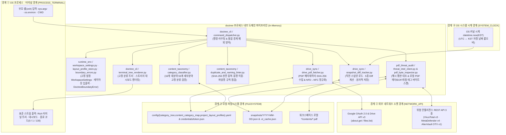
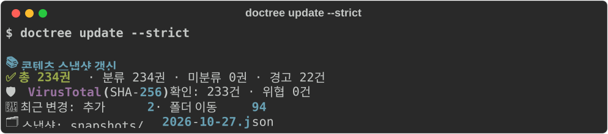
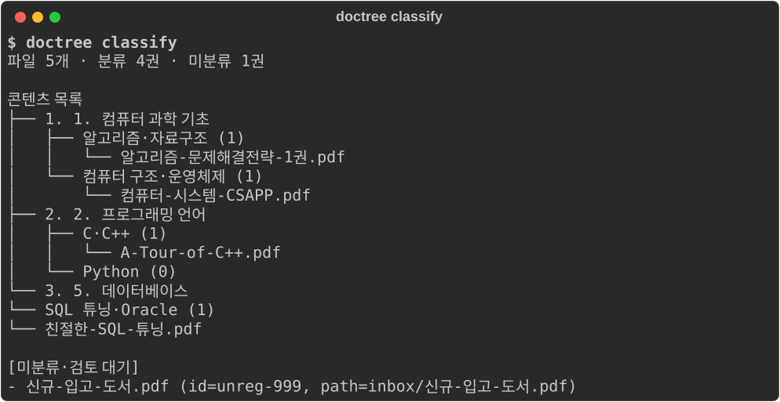
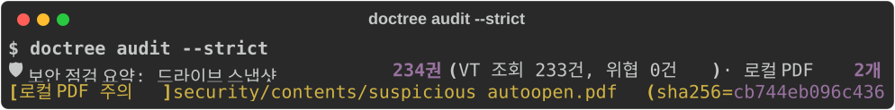
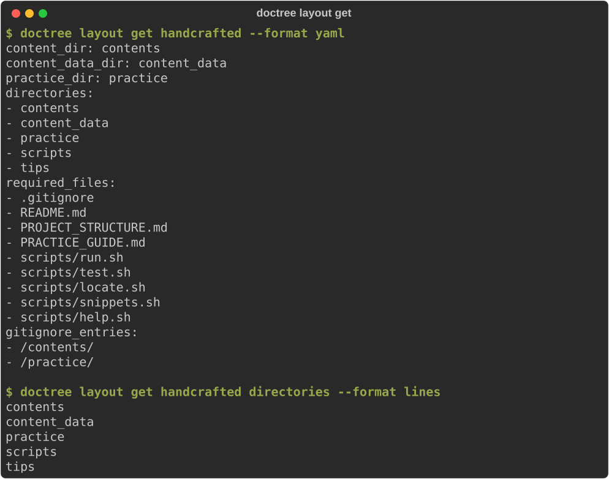
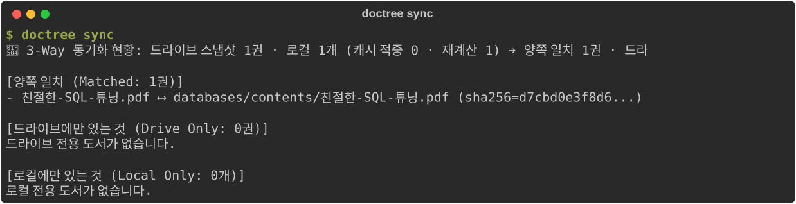
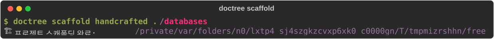
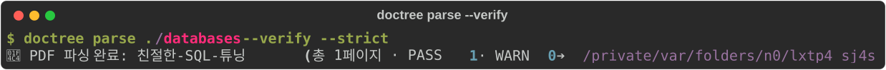
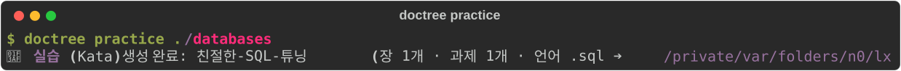

# 📚 doctree — 구글 드라이브 & 로컬 기술 도서 PDF 스냅샷·분류·레이아웃 규격·보안 감사 CLI

> 원본 PDF를 단 한 바이트도 내려받지 않고 구글 드라이브의 도서 메타데이터(`file_id`, `SHA-256`, 폴더 경로, 용량)만 수집해 일별 스냅샷(`snapshots/YYYY-MM-DD.json`)으로 기록하고, 16개 대분야·55개 세부분야 고정 분류 체계 검증(`category_tree.yaml` / `content_category_map.yaml`), 다일차 변경 추적(Diff), 중복·파일명 린팅, 프로젝트 레이아웃 프로필 CLI 입출력(`project_layout_profiles.yaml`), 그리고 다운로드 전·후 이중 PDF 위협 감사(VirusTotal / MetaDefender / OTX & 로컬 바이트 정적 분석)를 수행하는 파이썬 CLI 도구입니다.

---

## 🧭 목차

1. [프로젝트 개요 및 5대 핵심 특징](#1-프로젝트-개요-및-5대-핵심-특징)
2. [설계 원칙과 5대 핵심 규칙 (Invariants)](#2-설계-원칙과-5대-고정-규칙-invariants)
3. [프로그램 실행 흐름과 데이터 파이프라인 (Architecture & Flow)](#3-프로그램-실행-흐름과-데이터-파이프라인-architecture--flow)
4. [디렉토리·파일별 역할 및 분류 운영 규칙 (Directory & File Atlas)](#4-디렉토리파일별-역할-및-분류-운영-규칙-directory--file-atlas)
5. [입출력 데이터 스키마 명세 및 실제 터미널 출력 예시 (Data Schemas & Output)](#5-입출력-데이터-스키마-명세-및-실제-터미널-출력-예시-data-schemas--output)
6. [적용된 소프트웨어 공학 표준: 《Code Complete 2판》 · Python PEPs · 4대 외부 경계 예외](#6-적용된-소프트웨어-공학-표준-code-complete-2판--python-peps--4대-외부-경계-예외)
7. [시작하기 및 CLI 명령어 레퍼런스 (Quick Start & CLI Guide)](#7-시작하기-및-cli-명령어-레퍼런스-quick-start--cli-guide)
8. [4대 외부 경계 선언형 테스트 명세 및 100% 커버리지 검증](#8-4대-외부-경계-선언형-테스트-명세-및-100-커버리지-검증)

---

## 1. 프로젝트 개요 및 5대 핵심 특징

수백 권(수십 GB)의 기술 서적 PDF를 구글 드라이브에 보관하면서 로컬 학습 워크스페이스(`freeride`)의 여러 프로젝트 폴더(`*/contents/*.pdf`)에 배치해 활용하다 보면 다음과 같은 문제가 반복해서 발생합니다:

- 이름·폴더 변경 시 스냅샷 추적 단절: 드라이브에서 파일명을 다듬거나 폴더를 옮기면 기존 목록과 연결이 끊어져 새 파일로 오인됩니다.
- 폴더·파일명 기반 분류의 일관성 붕괴: 폴더 구조나 파일명 규칙에만 의존해 분류하면 폴더 정리 시 기존 분류 체계가 흔들리고 미분류 도서가 섞여 들어갑니다.
- 중복 파일 및 비표준 파일명 누적: 내용은 완전히 같은(`SHA-256` 동일) 사본이 여러 폴더에 흩어지거나, `Copy of ...`, `.pdf` 확장자 누락, macOS 한글 자모 분리(`NFD`) 파일이 섞여 들어옵니다.
- 악성 스크립트가 심어진 PDF 위험: 외부에서 구한 PDF 내부에 자동 실행 스크립트(`/JavaScript`, `/OpenAction`, `/Launch` 등)가 포함되어 있어도 열기 전에는 알기 어렵습니다.

`doctree`는 이 문제들을 5가지 핵심 메커니즘으로 해결합니다:

| 핵심 특징 | 동작 방식 및 보장 수준 |
|---|---|
| ① 무다운로드 경량 스냅샷 & 5종 변경 추적 | Google Drive API v3(`drive.readonly`)로 메타데이터와 `sha256Checksum`만 수집하여 `snapshots/YYYY-MM-DD.json`(한국 표준시 KST 기준)에 원자적으로 기록하고, 직전 스냅샷 대비 [추가 · 삭제 · 이름 변경 · 폴더 이동 · 내용(SHA-256) 변경] 5가지를 파일 ID 기준으로 정확히 분리 감지합니다. |
| ② 파일 ID 기반 결정론적 16대 분야 분류 | 파일명이나 드라이브 폴더가 바뀌어도 고유한 Google Drive `file_id`만을 키로 사용하여 [`config/category_tree.yaml`](config/category_tree.yaml)(16개 대분야·55개 세부분야)과 `config/content_category_map.yaml`([예시](config/content_category_map.example.yaml))에 따라 100% 결정론적으로 분류합니다. |
| ③ 무결성 우선 스냅샷 보호 가드 (Fail-Safe) | 인증 실패, API 조회 오류, 조회 결과 0건, YAML 스키마 오류, 엄격 모드(`--strict`) 미분류·보안 위협 감지 시 기존 스냅샷 파일을 단 1바이트도 건드리지 않고 그대로 보존한 채 종료 코드 `1`로 안전하게 중단합니다. |
| ④ 중복·동명 이종 파일·파일명 린터 | 스냅샷 레코드 전체를 순수 함수로 전수 검사하여 완전 중복(`exact_duplicate`, SHA-256 동일), 동명 이종 파일(`same_title_different_content`), 확장자 누락(`missing_pdf_extension`), `Copy of ` 접두어(`copy_of_prefix`), 앞뒤 공백(`surrounding_whitespace`) 경고를 검출합니다. |
| ⑤ 다운로드 전·후 이중 PDF 보안 감사 (`audit`) | 다운로드 전(원격)에는 드라이브 스냅샷의 `SHA-256` 해시를 VirusTotal API v3(및 로컬 캐시 `.vt_cache.json`)로 대조하고, 다운로드 후(로컬)에는 워크스페이스 `*/contents/*.pdf`의 원시 바이트를 스캔해 `%PDF-` 헤더·`%%EOF` 무결성과 6대 위험 실행 태그(`/JavaScript`, `/JS`, `/Launch`, `/EmbeddedFiles`, `/RichMedia`, `/XFA`) 및 다중 위협 인텔리전스(VT·MetaDefender·OTX) 평판을 교차 검증합니다. |
| ⑥ 프로젝트 레이아웃 프로필 입출력 및 구조 강제 (`layout` · `scaffold`) | [`config/project_layout_profiles.yaml`](config/project_layout_profiles.yaml)의 프로필(`handcrafted`, `research`, `toolchain`)별 폴더·필수 파일 규격을 `yaml` / `json` / `lines` 포맷으로 조회·수정(`doctree layout`)하고, 로컬 프로젝트를 표준 구조로 즉시 생성·검증(`doctree scaffold`)합니다. |
| ⑦ 3-Way 동기화 · 페이지별 PDF 파싱(DOT) · 실습(Kata) 생성 (`sync` · `pull` · `parse` · `practice`) | 로컬 `contents/` 해시 캐시(`.local_contents_cache.json`) 기반 3-Way 비교(`sync`) 및 다운로드(`pull`), 페이지별 마크다운·크롭 `.png`·Graphviz DOT `.svg` 추출 및 원본 PDF 5대 동일성 기계 검증(`parse --verify`), 그리고 장·절별 실습·테스트 프레임워크(`practice/`) 자동 생성(`practice`)까지 전 과정을 수행합니다. |

---

## 2. 설계 원칙과 5대 핵심 규칙 (Invariants)

코드베이스 전반의 일관성을 유지하고 회귀 버그를 막기 위해 다음 5대 핵심 규칙을 코드와 테스트로 강제합니다:

> [!IMPORTANT]
> 5대 아키텍처 규칙 (Architectural Invariants)
> 1. 분류 체계의 단일 진실 공급원 (`config/category_tree.yaml`): 16개 대분야와 55개 세부분야의 ID·이름·출력 순서는 오직 `config/category_tree.yaml`로만 정의됩니다. 콘텐츠가 0권인 빈 세부분야도 터미널 트리에서 생략하지 않고 그대로 표시합니다.
> 2. 추측 기반 자동 분류 금지 (`config/content_category_map.yaml`): 도서의 카테고리 배정은 오직 `content_category_map.yaml`의 `file_id -> category_id` 명시적 매핑으로만 이루어집니다. 폴더 경로(`folder_path`)나 책 제목(`name`/`title`)으로 카테고리를 유추하지 않으며, 미등록 파일 ID는 항상 트리 바깥의 `[미분류·검토 대기]` 영역에 격리합니다.
> 3. macOS `NFD` ↔ 표준 `NFC` 유니코드 경계 정규화: Google Drive API 응답이나 macOS(APFS) 파일시스템에서 유입되는 한글 자모 분리(`NFD`, 예: `ㅎ+ㅏ+ㄴ`) 문자열은 수집·비교·린팅·감사 경계에서 즉시 표준 완성형(`NFC`, 예: `한`)으로 정규화하여 오탐을 원천 차단합니다.
> 4. 원자적 파일 갱신(`Atomic Replace`) 및 순수 JSON 스냅샷 유지: 스냅샷(`YYYY-MM-DD.json`), 해시 캐시(`.vt_cache.json`), 레이아웃 프로필 설정(`project_layout_profiles.yaml`)은 항상 임시 파일(`.tmp`)에 먼저 기록한 뒤 `os.replace`로 원자적 교체를 수행합니다. 별도의 수동 마크다운 대장(`도서목록.md`, `변경이력.md`, `분류검토.md`)이나 `ledger/` 디렉터리는 생성하지 않습니다.
> 5. 《Code Complete 2판》 기반 스스로 설명하는(Self-Documenting) 1:1 대칭 구조: `config/`에는 순수 YAML만 두고, 배포 코드는 `src/doctree/<5대 도메인>/`에, 테스트 코드는 이와 1:1로 대응하는 `tests/<5대 도메인>/test_<모듈명>.py`에 배치합니다.

---

## 3. 프로그램 실행 흐름과 데이터 파이프라인 (Architecture & Flow)

### 3.1 4대 외부 통신·런타임 경계(`ExternalBoundary`)와 내부 도메인 결합도

컴퓨터 구조 및 OS 런타임 관점에서 `doctree` 프로세스는 4개의 외부 경계면(① OS 프로세스·터미널 / ② 외부 네트워크 소켓 API / ③ 로컬 파일시스템 VFS / ④ OS 시스템 시계)을 통해 외부 세계와 데이터를 주고받으며, 프로세스 메모리 내부에서는 5개 도메인 패키지가 파이프라인으로 결합됩니다.



### 3.2 5대 CLI 서브커맨드별 실행 흐름 요약

1. `doctree auth` / `doctree status` (인증 및 계정·스토리지 대시보드):
   - [`GoogleDriveManager`](src/doctree/drive_sync/drive_pdf_fetcher.py#L60-L148)가 로컬 `token.json` 또는 `credentials.json`을 확인하여 OAuth 2.0 인증(만료 시 자동 `refresh`, 최초 실행 시 로컬 브라우저 인가)을 수행한 뒤, `about.get` API로 전체 스토리지 한도·구글 드라이브 사용량(GB 및 비율 바 차트)을 출력합니다.
2. `doctree update [--strict]` (원격 조회 → 검증 → 감사 → 스냅샷 갱신 파이프라인):
   - Step 1 (목록 수집): `files.list` 페이지네이션으로 휴지통을 제외한 모든 도서 PDF(`mimeType == application/pdf` 또는 `.pdf` 확장자)의 `id`, `name`(NFC 정규화), `folder_path`(상위 폴더 트리 역추적), `size_bytes`, `sha256`, `modified_time`, `web_view_link`를 수집합니다.
   - Step 2 (분류 검증): [`load_catalog`](src/doctree/content_taxonomy/category_classifier.py#L148-L194)와 [`classify_records`](src/doctree/content_taxonomy/category_classifier.py#L197-L219)로 16개 분야 배정을 검증합니다. `--strict`에서 미분류 도서가 1건이라도 있으면 즉시 중단하고 기존 스냅샷을 보존합니다.
   - Step 3 (중복·파일명 린팅 및 해시 위협 감사): [`run_checks`](src/doctree/content_taxonomy/duplicate_and_naming_linter.py#L141-L148)로 중복·파일명 경고를 집계하고, [`audit_drive_records`](src/doctree/pdf_threat_audit/threat_intel_client.py#L290-L309)로 VirusTotal 해시 평판을 점검합니다(`--strict`에서 악성/의심 감지 시 저장 차단).
   - Step 4 (Diff 계산 및 원자적 저장): [`record_run`](src/doctree/drive_sync/snapshot_diff_tracker.py#L180-L195)이 직전 스냅샷을 먼저 읽어 5종 변경 사항(`추가·삭제·이름 변경·폴더 이동·내용 변경`)을 계산한 뒤, KST 기준 오늘자 `snapshots/YYYY-MM-DD.json`에 `.json.tmp` → `os.replace`로 원자적 저장을 수행합니다.
3. `doctree classify [--strict] [--snapshot PATH]` (완전 오프라인 분류 트리 검토):
   - 네트워크나 구글 드라이브 인증을 전혀 호출하지 않고, 지정한 스냅샷(생략 시 `snapshots/` 내 최신 날짜 스냅샷)과 `config/*.yaml`만 읽어 터미널에 16개 대분야·55개 세부분야 트리와 `[미분류·검토 대기]` 목록을 출력합니다.
4. `doctree audit [--strict] [PATHS...]` (원격 스냅샷 해시 + 로컬 PDF 바이트 이중 보안 감사):
   - 원격 스냅샷 레코드의 `SHA-256` 해시 평판과 로컬 워크스페이스(`*/contents/*.pdf`) 파일들의 실제 `SHA-256`, `%PDF-` 헤더, `%%EOF` 종료 마커, 6종 위험 실행 태그(`/JavaScript`, `/JS`, `/Launch`, `/EmbeddedFiles`, `/RichMedia`, `/XFA`)를 전수 점검합니다.
5. `doctree layout <get|set|add|remove>` (외부 컴포넌트 연동용 프로젝트 레이아웃 프로필 입출력):
   - [`layout_profile_store.py`](src/doctree/runtime_env/layout_profile_store.py)를 통해 [`config/project_layout_profiles.yaml`](config/project_layout_profiles.yaml)의 프로필(`handcrafted`, `research`, `toolchain`) 및 필드 값을 `yaml`/`json`/`lines` 포맷으로 조회(`get`)하거나, 스키마 검증과 원자적 교체(`os.replace`)를 거쳐 안전하게 수정(`set`/`add`/`remove`)합니다.

---

## 4. 디렉토리·파일별 역할 및 분류 운영 규칙 (Directory & File Atlas)

### 4.1 전체 디렉토리 트리 (`src/doctree/` ⟷ `tests/` 1:1 대칭 구조)

```text
doctree/
├── pyproject.toml                                       # PEP 517/518/621 단일 패키지·엔트리포인트·pytest·커버리지(100%) 설정
├── requirements.txt                                     # 런타임 및 개발·테스트 의존성 목록
├── .env.example                                         # 환경변수 설정 템플릿 (복사하여 .env로 사용)
├── AGENTS.md                                            # 분류 및 스냅샷 아키텍처 규칙 정의서
│
├── config/                                              # 순수 YAML 설정 데이터 (파이썬 코드 없음)
│   ├── category_tree.yaml                               # 16개 대분야·55개 세부분야 고정 분류 트리 정의 (category_tree_file)
│   ├── content_category_map.example.yaml                # Google Drive 파일 ID(file_id) ↔ 세부분야 ID(category_id) 배정표 예시 (복사해서 content_category_map.yaml로 사용, 실제 파일은 .gitignore 대상)
│   └── project_layout_profiles.yaml                     # 로컬 워크스페이스 프로젝트 프로필(handcrafted/research/toolchain) 규격 (project_layout_profiles_file)
│
├── snapshots/                                           # 일별 드라이브 스냅샷 원장 (.gitignore 대상 — 개인 메타데이터 보호)
│   ├── YYYY-MM-DD.json                                  # 실행 시점의 전체 PDF 메타데이터 스냅샷 (같은 날 재실행 시 덮어씀)
│   ├── .vt_cache.json                                   # SHA-256 해시별 위협 인텔리전스 조회 결과 로컬 캐시
│   └── .local_contents_cache.json                       # 로컬 워크스페이스 */contents/*.pdf 고속 스캔용 SHA-256 해시 캐시 (Step 1)
│
├── docs/screenshots/                                    # Rich Console(record=True)로 캡처한 실제 실행 화면 벡터 스크린샷 (.svg)
│   ├── doctree_update.svg                               # doctree update --strict 실행 화면
│   ├── doctree_classify.svg                             # doctree classify 실행 화면
│   ├── doctree_audit.svg                                # doctree audit --strict 실행 화면
│   ├── doctree_layout.svg                               # doctree layout get 실행 화면
│   ├── doctree_sync.svg                                 # doctree sync 3-Way 동기화 비교 화면 (Step 1)
│   ├── doctree_scaffold.svg                             # doctree scaffold 프로젝트 구조 강제 생성 화면 (Step 2)
│   ├── doctree_parse.svg                                # doctree parse --verify 페이지별 파싱 및 동일성 검증 화면 (Step 3)
│   ├── doctree_practice.svg                             # doctree practice 실습(Kata) 프레임워크 생성 화면 (Step 4)
│   └── doctree_error_guard.svg                          # 경계 검증 실패 및 스냅샷 보존 가드 실행 화면
│
├── src/doctree/                                         # PyPA 표준 src-layout + 스스로 설명하는(Self-Documenting) 5대 도메인 패키지
│   ├── __init__.py                                      # 패키지 버전(__version__ = "0.1.0")
│   ├── runtime_env/                                     # [도메인 1] 런타임 환경 설정, 레이아웃 프로필·스캐폴딩 및 4대 외부 경계 통합 예외 관리
│   │   ├── workspace_settings.py                        # 고정(frozen/slots) WorkspaceSettings 및 경로·환경변수 로더
│   │   ├── layout_profile_store.py                      # project_layout_profiles.yaml 스키마 검증 및 원자적 조회·갱신 저장소
│   │   ├── project_scaffolder.py                        # 로컬 프로젝트 폴더·필수 파일·실행 스크립트·gitignore 스캐폴더 (Step 2)
│   │   └── boundary_errors.py                           # ExternalBoundary(4종)·BoundaryKind(6종)·DoctreeBoundaryError 통합 예외 계층
│   ├── drive_sync/                                    # [도메인 2] 구글 드라이브 API 수집, 일별 스냅샷 변경 추적 및 3-Way 동기화
│   │   ├── drive_pdf_fetcher.py                         # Google Drive API v3(about.get, files.list) 연동 및 DrivePdfRecord 생성
│   │   ├── snapshot_diff_tracker.py                     # KST 자정 기준 스냅샷 원자적 저장 및 5종 변경(Changes) 비교기
│   │   └── workspace_sync_engine.py                     # 로컬 contents/ 고속 해시 스캔, 3-Way 정합성 대조(sync) 및 도서 가져오기(pull) (Step 1)
│   ├── content_taxonomy/                                # [도메인 3] 고정 카테고리 분류 체계 검증, 중복·파일명 린터 및 실습(Kata) 빌더
│   │   ├── category_classifier.py                       # 중복 키 방지 YAML 파서(_UniqueKeySafeLoader) 및 파일 ID 분류기
│   │   ├── duplicate_and_naming_linter.py               # SHA-256 완전 중복·동명 이종 파일·확장자/접두어/공백 점검 순수 함수
│   │   └── practice_kata_builder.py                     # content_data/*page.md 장·절 그룹핑 및 practice/ 실습 코드·테스트 생성기 (Step 4)
│   ├── pdf_threat_audit/                                # [도메인 4] 로컬 PDF 정적 바이트 분석, 외부 위협 인텔리전스 연동 및 페이지별 파서
│   │   ├── pdf_byte_inspector.py                        # PDF 헤더(%PDF-)·종료(%%EOF)·6종 위험 실행 태그 슬라이딩 윈도우 스캐너
│   │   ├── pdf_page_ingestor.py                         # 페이지별 마크다운·크롭 PNG·DOT SVG 추출 및 원본 PDF 5대 동일성 검증기 (Step 3)
│   │   └── threat_intel_client.py                       # ThreatIntelProvider Protocol (VirusTotal v3 · MetaDefender v4 · OTX v1)
│   └── doctree_cli/                                     # [도메인 5] CLI 명령 디스패처 및 Rich 터미널 렌더러
│       ├── command_dispatcher.py                        # argparse 서브커맨드(auth/status/update/classify/audit/layout/sync/pull/scaffold/parse/practice)
│       └── terminal_tree_renderer.py                    # 고정 분류 트리 포매터 및 드라이브 스토리지 대시보드 렌더러
│
└── tests/                                               # src/doctree/ 와 1:1 대칭되는 테스트 모듈 + 선언형 명세(.feature/.yaml)
    ├── runtime_env/
    │   ├── test_workspace_settings.py                   # 환경 설정, 1:1 대칭 구조, 의존성·문서 무결성 검증
    │   ├── test_layout_profile_store.py                 # project_layout_profiles.yaml 스키마 및 doctree layout CLI 입출력 검증
    │   ├── test_project_scaffolder.py                   # 프로필별 디렉토리·필수 파일·스크립트 스캐폴딩 및 검증 테스트 (Step 2)
    │   └── test_boundary_errors.py                      # 4대 외부 경계 예외 계층, KST 자정, NFD↔NFC, 저장소 실제 데이터 계약 검증
    ├── drive_sync/
    │   ├── drive_api_cassettes.yaml                     # [선언형 명세] Google Drive API v3 about.get & files.list 페이지네이션 카세트
    │   ├── test_drive_pdf_fetcher.py                    # OAuth/서비스 계정 인증, 폴더 트리 해석, 슬래시 파일명, 카세트 통합 검증
    │   ├── test_snapshot_diff_tracker.py                # 스냅샷 원자적 저장, 동일 일자 덮어쓰기, 5종 Diff 및 변경 여부 검증
    │   └── test_workspace_sync_engine.py                # 고속 로컬 해시 캐시, 3-Way 비교(sync) 및 도서 다운로드(pull) 검증 (Step 1)
    ├── content_taxonomy/
    │   ├── test_category_classifier.py                  # 스키마 경계값, 중복 키/ID 차단, 엄격/비엄격 분류 검증
    │   ├── test_duplicate_and_naming_linter.py          # 5종 WarningKind 정렬, 정규화, 입력 변경 여부 검증
    │   └── test_practice_kata_builder.py                # 장·절별 practice/ 실습 패키지(README.md, main.*, test.*) 생성 검증 (Step 4)
    ├── pdf_threat_audit/
    │   ├── http_cassettes.yaml                          # [선언형 명세] VirusTotal v3 · MetaDefender v4 · OTX v1 HTTP 응답 카세트
    │   ├── test_pdf_byte_inspector.py                   # 청크 경계(1MB) 분할 위험 태그 탐지, 헤더/EOF 손상, 심볼릭 링크 중복 제거
    │   ├── test_pdf_page_ingestor.py                    # 페이지별 PDF 파싱, DOT SVG 렌더링 및 5대 동일성 기계 검증 테스트 (Step 3)
    │   └── test_threat_intel_client.py                  # 로컬 루프백(127.0.0.1) 실제 TCP HTTP 서버 연동 및 캐시 원자성 검증
    └── doctree_cli/
        ├── doctree_workflows.feature                    # [선언형 명세] pytest-bdd 한글 Gherkin 실행 가능한 워크플로 시나리오 5종
        ├── cli_golden_transcripts.yaml                  # [선언형 명세] 실제 .venv/bin/doctree 바이너리 E2E 골든 트랜스크립트 14종
        ├── test_command_dispatcher.py                   # 전 CLI 서브커맨드 단위·통합·BDD·서브프로세스 E2E 검증
        └── test_terminal_tree_renderer.py               # 터미널 분류 트리 및 계정 대시보드 렌더링 검증
```

### 4.2 산출물(`snapshots/`) 및 고정 분류 설정(`config/`) 운영 규칙

#### 📂 산출물 (`snapshots/`)
- `snapshots/YYYY-MM-DD.json`: 실행 시점의 전체 PDF 메타데이터 스냅샷입니다(같은 날 재실행 시 덮어씀).
- 별도의 마크다운 파일(`도서목록.md`, `변경이력.md`, `분류검토.md`)이나 `ledger/` 폴더는 생성하지 않고 JSON 스냅샷만 보관합니다.
- `snapshots/`는 개인 드라이브 메타데이터가 담기므로 git에 커밋하지 않습니다(`.gitignore` 대상).

#### 🗂️ 고정 분류 트리 및 새 콘텐츠(새 책) 추가 방법 (`config/`)
- 현재 콘텐츠 목록의 16개 분야와 55개 세부분야는 [`config/category_tree.yaml`](config/category_tree.yaml)에 고정되어 있습니다. 이름과 출력 순서는 이 파일의 목록 순서를 따르며, 콘텐츠가 없는 빈 분야와 세부분야도 그대로 유지합니다.
- `config/content_category_map.yaml`(개인 Drive 파일 ID가 담기므로 `.gitignore` 대상, [`config/content_category_map.example.yaml`](config/content_category_map.example.yaml)을 복사해 시작)은 Google Drive 파일 ID(`file_id`)를 세부분야 ID(`category_id`)에 연결합니다. 파일 이름이나 폴더를 바꿔도 파일 ID가 같으면 분류가 유지되며, `title`은 관리용 설명일 뿐 자동 매칭에 사용하지 않습니다.
- 새 콘텐츠(새 책) 추가 워크플로:
  1. 구글 드라이브에 새 PDF를 올린 뒤 `doctree update` 또는 `doctree classify`를 실행하면 `[미분류·검토 대기]` 섹션에 파일 ID(`id=...`)와 함께 표시됩니다.
  2. `config/content_category_map.yaml`의 `contents` 목록에 아래와 같이 배정을 추가하고 다시 실행합니다:
     ```yaml
     - file_id: "구글 드라이브 링크의 파일 ID"
       title: "새 콘텐츠 제목"
       category_id: "cs.algorithms"
     ```
- 중복·검증 오류: 중복 파일 ID 배정, 중복 노드 ID·YAML 키, 존재하지 않는 세부분야 또는 대분야(`cs` 등) 직접 배정은 항상 검증 오류(`ClassificationError`)로 처리됩니다.

#### 🏗️ 프로젝트 레이아웃 프로필 규격 및 외부 컴포넌트 CLI 연동 ([`config/project_layout_profiles.yaml`](config/project_layout_profiles.yaml))
- 워크스페이스 하위 컴포넌트들의 유형별(`handcrafted`, `research`, `toolchain`) 표준 디렉터리(`directories`), 필수 파일(`required_files`), `.gitignore` 항목(`gitignore_entries`) 규격을 정의합니다.
- 다른 컴포넌트나 셸 스크립트에서 `doctree layout get [profile] [field] --format yaml|json|lines`로 규격 값을 읽어오거나, `doctree layout set|add|remove`로 스키마 검증 및 원자적 교체(`os.replace`)를 수행할 수 있습니다.

---

## 5. 입출력 데이터 스키마 명세 및 실제 터미널 출력 예시 (Data Schemas & Output)

### 5.1 5대 입출력 파일 데이터 스키마 명세

#### ① 고정 분류 트리 스키마 ([`config/category_tree.yaml`](config/category_tree.yaml))
- `schema_version`은 반드시 정수 `1`(`bool` 제외)이어야 하며, 모든 대분야·세부분야 `id`는 전역 유일한 영문 소문자 식별자(`[a-z][a-z0-9]*(?:[._-][a-z0-9]+)*`)여야 합니다.

```yaml
schema_version: 1
categories:
  - id: cs
    name: "1. 컴퓨터 과학 기초"
    subcategories:
      - id: cs.algorithms
        name: "알고리즘·자료구조"
      - id: cs.systems
        name: "컴퓨터 구조·운영체제"
```

#### ② 파일 ID별 분류 배정 매핑 스키마 ([`config/content_category_map.example.yaml`](config/content_category_map.example.yaml))
- `file_id`는 중복될 수 없으며, `category_id`는 반드시 `category_tree.yaml`의 말단 세부분야(`subcategories[].id`) 중 하나여야 합니다(대분야 ID 직접 배정 불가).

```yaml
schema_version: 1
contents:
  - file_id: "1AbCdEfGhIjKlMnOpQrStUvWxYz012345"
    title: "A Tour of C++"
    category_id: "languages.c-cpp"
  - file_id: "1ZyXwVuTsRqPoNmLkJiHgFeDcBa543210"
    title: "친절한 SQL 튜닝"
    category_id: "databases.oracle-tuning"
```

#### ③ 프로젝트 레이아웃 프로필 스키마 ([`config/project_layout_profiles.yaml`](config/project_layout_profiles.yaml) · [`layout_profile_store.py`](src/doctree/runtime_env/layout_profile_store.py))
- 각 프로필은 선택적 디렉터리 별칭(`content_dir`, `content_data_dir`, `practice_dir`)과 3대 필수 문자열 목록(`directories`, `required_files`, `gitignore_entries`, 목록 내 중복 불허)으로 구성됩니다.

```yaml
schema_version: 1
profiles:
  handcrafted:
    content_dir: "contents"
    content_data_dir: "content_data"
    practice_dir: "practice"
    directories:
      - "content_data"
      - "contents"
      - "practice"
      - "scripts"
      - "tips"
      - ".opensource"
    required_files:
      - ".gitignore"
      - "README.md"
      - "PROJECT_STRUCTURE.md"
      - "PRACTICE_GUIDE.md"
    gitignore_entries:
      - "/contents/"
      - "/practice/"
```

#### ④ 일별 드라이브 스냅샷 JSON 스키마 (`snapshots/YYYY-MM-DD.json` · [`DrivePdfRecord`](src/doctree/drive_sync/drive_pdf_fetcher.py#L34-L43))
- 레코드는 `id` 사전순, JSON 키는 알파벳순(`sort_keys=True`)으로 정렬되어 동일 입력에 대해 항상 100% 동일한 바이트 출력을 보장합니다.

```json
{
  "count": 234,
  "records": [
    {
      "folder_path": "knowledge-base/raw-data/C & C++",
      "id": "1AbCdEfGhIjKlMnOpQrStUvWxYz012345",
      "modified_time": "2026-10-12T15:35:28.315Z",
      "name": "A-Tour-of-C++",
      "sha256": "0f1e2d3c4b5a69788796a5b4c3d2e1f00f1e2d3c4b5a69788796a5b4c3d2e1f0",
      "size_bytes": 12345678,
      "web_view_link": "https://drive.google.com/file/d/1AbCdEfGhIjKlMnOpQrStUvWxYz012345/view?usp=drivesdk"
    }
  ],
  "taken_at": "2026-10-27T20:34:12+09:00"
}
```

#### ⑤ 위협 인텔리전스 해시 평판 캐시 스키마 (`snapshots/.vt_cache.json` · [`VtVerdict`](src/doctree/pdf_threat_audit/threat_intel_client.py#L36-L46))
- 64자리 SHA-256 해시를 키로 하며, `status`는 [`VerdictStatus`](src/doctree/pdf_threat_audit/threat_intel_client.py#L26-L33)(`clean`, `malicious`, `suspicious`, `not_found`, `error`) 값을 가집니다(`error` 상태는 캐시하지 않고 다음 실행 시 재시도).

```json
{
  "0f1e2d3c4b5a69788796a5b4c3d2e1f00f1e2d3c4b5a69788796a5b4c3d2e1f0": {
    "detail": "",
    "harmless": 72,
    "malicious": 0,
    "status": "clean",
    "suspicious": 0,
    "undetected": 4
  }
}
```

---

### 5.2 서브커맨드별 실제 터미널 실행 화면 스크린샷 (SVG) 및 텍스트 예시

아래 스크린샷은 실제 `doctree` 실행 출력을 `rich.console.Console(record=True).save_svg()`로 캡처한 벡터(`.svg`) 터미널 화면입니다.

#### ① `doctree update --strict` (원격 스냅샷 갱신 · 해시 감사 · 변경 요약)



```text
📚 콘텐츠 스냅샷 갱신
✅ 총 234권 · 분류 234권 · 미분류 0권 · 경고 0건
🛡️ VirusTotal(SHA-256) 확인: 234건 · 위협 0건
🔄 최근 변경: 추가 2
🗂️ 스냅샷: snapshots/2026-10-27.json
```

#### ② `doctree classify` (오프라인 고정 분류 트리 및 미분류 검토)



```text
파일 5개 · 분류 4권 · 미분류 1권
├── 1. 컴퓨터 과학 기초
│   ├── 알고리즘·자료구조 (1)
│   │   └── 알고리즘-문제해결전략-1권.pdf
│   └── 컴퓨터 구조·운영체제 (1)
│       └── 컴퓨터-시스템-CSAPP.pdf
├── 2. 프로그래밍 언어
│   ├── C·C++ (1)
│   │   └── A-Tour-of-C++.pdf
│   └── Python (0)
└── 5. 데이터베이스
    └── SQL 튜닝·Oracle (1)
        └── 친절한-SQL-튜닝.pdf

[미분류·검토 대기]
- 신규-입고-도서.pdf (id=unreg-999, path=inbox/신규-입고-도서.pdf)
```

#### ③ `doctree audit --strict` (원격 스냅샷 해시 + 로컬 PDF 바이트 정적 보안 감사)



```text
🛡️ 보안 점검 요약: 드라이브 스냅샷 234권(VT 조회 234건, 위협 0건) · 로컬 PDF 2개(주의/위협 1개)
[로컬 PDF 주의] security/contents/suspicious_autoopen.pdf (sha256=3bc1cf6e7900d864... · 위험 태그: /JavaScript)
```

#### ④ `doctree layout get` (외부 컴포넌트 연동용 레이아웃 프로필 조회)



```text
$ doctree layout get handcrafted directories --format lines
contents
content_data
practice
scripts
tips
```

#### ⑤ 경계 오류 발생 시 일관된 에러 출력 및 스냅샷 보존 가드 (`doctree update --strict`)


```text
📚 콘텐츠 스냅샷 갱신
❌ 분류 검증 실패: 미분류 콘텐츠 1권: 'unregistered-999'
기존 스냅샷은 그대로 두었습니다.
```

#### ⑥ Step 1~4 파이프라인 실행 화면 (`sync` · `scaffold` · `parse --verify` · `practice`)









---

## 6. 적용된 소프트웨어 공학 표준: 《Code Complete 2판》 · Python PEPs · 4대 외부 경계 예외

### 6.1 패키지 분할 및 작명 원칙 (《Code Complete 2판》 기준)

본 저장소([contents-overview-tocs.md](../coding-style-refactoring-principles/contents-overview-tocs.md#L27-L255))의 《Code Complete 2판》(Steve McConnell)이 정의한 모듈화 및 문제 지향적 작명 원칙을 따릅니다:

| 《Code Complete 2판》 장·절 | 핵심 원칙 | `doctree` 적용 내역 |
|---|---|---|
| 제5장 구현 설계 (5.2 설계의 계층 / 5.3 응집도와 결합도) & 제6장 클래스 다듬기 (6.6 클래스를 넘어서: 패키지) | 시스템을 높은 응집도와 낮은 결합도를 가진 서브시스템·패키지 단위로 분할하여 인지 복잡도를 낮춘다. | `src/doctree/` 하위를 역할별 5개 패키지(`runtime_env`, `drive_sync`, `content_taxonomy`, `pdf_threat_audit`, `doctree_cli`)로 분할하고 `tests/`와 1:1 대칭 구성 |
| 제7장 고급 루틴 (7.3 좋은 루틴 이름) & 제11장 변수 이름의 힘 (11.1 좋은 이름을 위한 고려 사항 / 11.5 피해야 할 이름) | 모호한 범용 단어(`process`, `handle`, `data`, `config`, `layout`)나 서로 비슷해 헷갈리는 이름을 피하고, 무엇(What)을 다루는지 완전하고 정확하게 서술하는 문제 지향적 이름(Problem-Oriented Name)을 짓는다. | • 설정 파일 3종을 역할이 즉시 드러나도록 [`category_tree.yaml`](config/category_tree.yaml)(`category_tree_file`), [`content_category_map.yaml`](config/content_category_map.example.yaml)(`content_category_map_file`), [`project_layout_profiles.yaml`](config/project_layout_profiles.yaml)(`project_layout_profiles_file`)로 명명<br>• 파이썬 모듈도 [`workspace_settings.py`](src/doctree/runtime_env/workspace_settings.py), [`layout_profile_store.py`](src/doctree/runtime_env/layout_profile_store.py), [`drive_pdf_fetcher.py`](src/doctree/drive_sync/drive_pdf_fetcher.py), [`threat_intel_client.py`](src/doctree/pdf_threat_audit/threat_intel_client.py)로 명명 |
| 제32장 스스로를 설명하는 코드 (32.2 문서화를 위한 프로그래밍 스타일) | 부가 설명 없이 패키지·파일·심볼 이름과 구조 자체가 문서 역할(Self-Documenting Code)을 수행해야 한다. | 디렉토리 트리와 모듈명만 읽어도 환경 설정·드라이브 스냅샷·분류 검증·PDF 보안 감사·CLI 렌더링 흐름이 드러나도록 구성 |

### 6.2 적용된 파이썬 공식 명세 (PEP) 및 참고 링크

| 적용 기능 | 공식 명세 및 참고 링크 | 도입 버전 | 적용 목적 및 코드 위치 |
|---|---|---|---|
| `pyproject.toml` 단일 패키징 & `src/` 레이아웃 | • [PEP 517 – Build-system independent format](https://peps.python.org/pep-0517/)<br>• [PEP 518 – Specifying Build System Requirements](https://peps.python.org/pep-0518/)<br>• [PEP 621 – Storing project metadata in pyproject.toml](https://peps.python.org/pep-0621/)<br>• [PyPA – src layout vs flat layout](https://packaging.python.org/en/latest/discussions/src-layout-vs-flat-layout/) | Python 3.8~3.11 | `setup.py` 없이 [`pyproject.toml`](pyproject.toml) 단일 파일로 프로젝트 메타데이터·빌드·`pytest`·`coverage` 설정을 선언하고, 배포 패키지를 `src/doctree/`로 격리하여 작업 디렉토리 오염 방지 |
| `@dataclass(frozen=True, slots=True)` | • [PEP 557 – Data Classes](https://peps.python.org/pep-0557/)<br>• [CPython bpo-42269 / gh-86435 (`slots=True`)](https://github.com/python/cpython/issues/86435) | PEP 557 (3.7)<br>`slots=True` (3.10) | 도메인 값 객체(`WorkspaceSettings`, `Category`, `VtVerdict`, `LocalPdfAudit`, `Change`, `RunResult`)의 수정 방지(`FrozenInstanceError`) 보장 및 인스턴스별 `__dict__` 제거를 통한 메모리 절약 |
| `typing.TypedDict` | • [PEP 589 – TypedDict: Type Hints for Dictionaries with a Fixed Set of Keys](https://peps.python.org/pep-0589/)<br>• [PEP 655 – Marking individual TypedDict items as required or potentially-missing](https://peps.python.org/pep-0655/) | Python 3.8 / 3.11 | 런타임에는 일반 `dict`로 동작해 JSON 직렬화(`json.dumps`) 오버헤드가 0이면서, 스냅샷 레코드([`DrivePdfRecord`](src/doctree/drive_sync/drive_pdf_fetcher.py#L34-L43))의 7개 필수 키와 값 타입을 정적으로 강제 |
| `enum.StrEnum` | • [PEP 435 – Adding an Enum type to the Python standard library](https://peps.python.org/pep-0435/)<br>• [PEP 663 – Standardizing Enum str(), repr(), and format() behaviors](https://peps.python.org/pep-0663/)<br>• [Python Docs – `enum.StrEnum`](https://docs.python.org/3/library/enum.html#enum.StrEnum) | Python 3.11 | 매직 스트링 오타를 방지하면서도 `str`을 다중 상속하여 일반 문자열 비교(`VerdictStatus.MALICIOUS == "malicious"`) 및 JSON 직렬화와 100% 호환 (`ExternalBoundary`, `BoundaryKind`, `VerdictStatus`, `WarningKind`) |
| `typing.Protocol` & `@runtime_checkable` | • [PEP 544 – Protocols: Structural subtyping (static duck typing)](https://peps.python.org/pep-0544/) | Python 3.8 | 명시적 부모 클래스(`ABC`) 상속 없이도 `query_hash(sha256: str) -> VtVerdict` 시그니처만 구현하면 동일한 위협 인텔리전스 인터페이스로 다형성 교체 가능 ([`ThreatIntelProvider`](src/doctree/pdf_threat_audit/threat_intel_client.py#L49-L92)) |
| 모듈 `__getattr__` 지연 로딩 (Lazy Import) | • [PEP 562 – Module `__getattr__` and `__dir__`](https://peps.python.org/pep-0562/) | Python 3.7 | 패키지 Facade([`doctree_cli/__init__.py`](src/doctree/doctree_cli/__init__.py))에서 심볼 접근 시점에 하위 모듈을 지연 로드하여 초기 구동 속도를 높이고 `python -m` 실행 시 `runpy` 중복 로드 경고를 원천 차단 |
| 지연 평가 타입 어노테이션 & 유니온 연산자 (`\|`) | • [PEP 563 – Postponed Evaluation of Annotations](https://peps.python.org/pep-0563/)<br>• [PEP 604 – Allow writing union types as `X \| Y`](https://peps.python.org/pep-0604/) | Python 3.7 (`__future__`)<br>Python 3.10 (`X \| Y`) | `from __future__ import annotations`로 클래스 자기 참조(`-> WorkspaceSettings`) 및 순환 임포트를 방지하고, `Union[A, B]` 대신 `A \| B` 표준 연산자 사용 |

### 6.3 4대 외부 경계 통합 예외 계층 ([`boundary_errors.py`](src/doctree/runtime_env/boundary_errors.py))

외부 세계와 통신하는 접점에서 발생하는 모든 예외는 [`DoctreeBoundaryError`](src/doctree/runtime_env/boundary_errors.py#L57-L93) 단일 계층으로 승격되어, 스택트레이스 노출 없이 일관된 한국어 에러 메시지와 종료 코드(`1`, 시그널 중단 시 `130`)로 처리됩니다:

| 예외 클래스 | 다중 상속 기반 | 상위 외부 경계 (`ExternalBoundary`) | 일관된 터미널 출력 형식 (`format_error()`) |
|---|---|---|---|
| [`DriveAuthError`](src/doctree/runtime_env/boundary_errors.py#L96-L108) | `DoctreeBoundaryError`, `RuntimeError` | `NETWORK_API` | `❌ 구글 드라이브 인증에 실패했거나 credentials.json / token.json이 없습니다. doctree auth를 먼저 실행하세요.` |
| [`DriveListError`](src/doctree/runtime_env/boundary_errors.py#L111-L114) | `DoctreeBoundaryError`, `RuntimeError` | `NETWORK_API` | `❌ 드라이브 목록 조회 실패: <상세 사유>` |
| [`ClassificationError`](src/doctree/runtime_env/boundary_errors.py#L117-L120) | `DoctreeBoundaryError`, `ValueError` | `FILESYSTEM` | `❌ 분류 검증 실패: <YAML/스냅샷 스키마 또는 미분류 사유>` |
| [`SnapshotStorageError`](src/doctree/runtime_env/boundary_errors.py#L123-L126) | `DoctreeBoundaryError`, `OSError` | `FILESYSTEM` | `❌ 파일 입출력 실패: <파일 경로 및 I/O 사유>` |
| [`SecurityAuditError`](src/doctree/runtime_env/boundary_errors.py#L129-L132) | `DoctreeBoundaryError`, `RuntimeError` | `FILESYSTEM` / `NETWORK_API` | `❌ VirusTotal 위협 감지 N건: <파일명 목록>` |

---

## 7. 시작하기 및 CLI 명령어 레퍼런스 (Quick Start & CLI Guide)

### 7.1 가상환경 및 패키지 설치

```bash
# 1) 전역 CLI 설치 (.venv 패키지 설치 + ~/.local/bin/doctree 등록)
./install.sh

# 2) 또는 가상환경(.venv) 수동 활성화 및 개발·테스트 의존성 설치
python3 -m venv .venv
source .venv/bin/activate
pip install -e ".[dev]"
```

### 7.2 Google OAuth 클라이언트 키 (`credentials.json`) 및 환경 변수

1. Google Cloud Console에서 프로젝트를 만들고 Google Drive API를 사용 설정합니다.
2. *API 및 서비스 → 사용자 인증 정보 → OAuth 클라이언트 ID 만들기*에서 애플리케이션 유형을 데스크톱 앱으로 선택합니다.
3. 내려받은 JSON을 저장소 루트에 `credentials.json`으로 둡니다.
4. 최초 로그인 시 브라우저가 열리고 승인 후 `token.json`이 생성됩니다:

```bash
doctree auth
```

요청 권한은 `drive.readonly`뿐이며 드라이브의 원본 파일을 수정하거나 삭제하지 않습니다.

> [!WARNING]
> OAuth "테스트" 모드의 토큰 만료 (7일 주기)
> Google Cloud OAuth 동의 화면이 테스트 상태(게시 전)이면 refresh token이 7일 뒤 만료됩니다. 인증 오류가 발생하면 `token.json`을 삭제하고 다시 로그인하세요:
> ```bash
> rm token.json && doctree auth
> ```

[`.env.example`](.env.example)을 `.env`로 복사해 설정 가능한 환경 변수:

| 변수 | 기본값 | 설명 |
|---|---|---|
| `GOOGLE_SERVICE_ACCOUNT_FILE` | `credentials.json` | 인증 키 파일 경로 (`token.json`은 같은 폴더에 생성) |
| `GOOGLE_DRIVE_FOLDER_ID` | (없음 = 드라이브 전체) | 지정 시 해당 폴더 하위 트리만 상대 경로로 스캔 |
| `DOCTREE_SNAPSHOTS_DIR` | `snapshots/` | 일별 스냅샷 출력 디렉터리 |
| `DOCTREE_CATEGORY_TREE_FILE` | `config/category_tree.yaml` | 16개 대분야·55개 세부분야 고정 분류 트리 정의 파일 (`category_tree_file`) |
| `DOCTREE_CONTENT_CATEGORY_MAP_FILE` | `config/content_category_map.yaml` | Drive 파일 ID별 세부분야 배정 매핑 파일 (`content_category_map_file`) |
| `DOCTREE_PROJECT_LAYOUT_PROFILES_FILE` | `config/project_layout_profiles.yaml` | 프로젝트 유형별 디렉터리·필수 파일 레이아웃 규격 파일 (`project_layout_profiles_file`) |
| `VIRUSTOTAL_API_KEY` | (선택) | 설정 시 드라이브 및 로컬 PDF의 SHA-256 해시를 VirusTotal API v3로 조회 (`snapshots/.vt_cache.json` 캐싱) |
| `DOCTREE_VT_CACHE_FILE` | `snapshots/.vt_cache.json` | 해시 평판 조회 캐시 파일 경로 |
| `FREERIDE_WORKSPACE_DIR` | `..` (상위 폴더) | `doctree audit` 실행 시 로컬 `*/contents/*.pdf`를 탐색할 워크스페이스 루트 |

### 7.3 CLI 명령어 레퍼런스

```bash
doctree --help                                             # 전체 워크플로·서브커맨드·설정 파일 상세 한글 도움말 출력
doctree help [COMMAND]                                     # 전체 도움말 또는 특정 서브커맨드(예: doctree help update) 상세 안내
doctree --version                                          # 설치된 doctree 버전(0.1.0) 출력
doctree auth                                               # OAuth 2.0 로그인(token.json 생성·갱신) 후 연동 상태 출력
doctree status                                             # 스토리지 용량 대시보드 출력
doctree update                                             # 조회 → 분류 → 점검 → snapshots/YYYY-MM-DD.json 저장 및 요약 출력
doctree update --strict                                    # 미분류 도서 또는 VT 위협이 있으면 스냅샷을 저장하지 않고 실패(종료 코드 1)
doctree update --snapshots-dir DIR                         # 지정한 디렉터리에 스냅샷 저장
doctree classify                                           # 최신 로컬 스냅샷으로 오프라인 분류 트리·미분류 검토 출력 (Drive 미호출)
doctree classify --snapshot snapshots/2026-10-27.json --strict
doctree audit                                              # 드라이브 스냅샷(SHA-256) + 로컬 전체 contents/*.pdf 보안·무결성 점검
doctree audit --strict                                     # VirusTotal 위협 또는 로컬 PDF 위험 태그(/JavaScript, /Launch 등)·손상 발견 시 실패
doctree layout get [PROFILE] [FIELD] [--format yaml|json|lines] # 프로젝트 레이아웃 프로필 전체 또는 특정 프로필·필드 조회
doctree layout set <PROFILE> <FIELD> <VALUES...>           # 레이아웃 프로필의 스칼라/목록 필드를 새 값으로 원자적 갱신
doctree layout add <PROFILE> <FIELD> <ITEMS...>            # 레이아웃 프로필 목록 필드(directories, required_files 등)에 항목 추가
doctree layout remove <PROFILE> <FIELD> <ITEMS...>         # 레이아웃 프로필 목록 필드에서 항목 제거
doctree sync [--snapshot PATH] [--workspace-dir DIR]       # [Step 1] 드라이브 스냅샷(SHA-256) ⟷ 로컬 contents/(SHA-256) 3-Way 동기화 비교
doctree pull <QUERY> <PROJECT> [--output-name NAME]        # [Step 1] 드라이브 PDF를 특정 로컬 프로젝트의 contents/로 내려받기 및 해시 검증
doctree scaffold <PROFILE> <PATH> [--overwrite] [--check]  # [Step 2] 로컬 프로젝트 폴더·필수 파일·스크립트·gitignore 표준 구조 강제 생성 및 검증
doctree parse <TARGET> [--verify] [--strict]               # [Step 3] 페이지별 PDF 파싱(.md + 크롭 .png + DOT .svg) 및 5대 동일성 기계 검증
doctree practice <TARGET> [--lang py|cpp|java|sql]         # [Step 4] content_data/ 중간 결과물을 장·절별로 묶어 practice/ 실습 프레임워크 생성
```

---

## 8. 4대 외부 경계 선언형 테스트 명세 및 100% 커버리지 검증

단위 테스트 코드만으로는 파악하기 어려운 외부 통신 경계와 종단간(E2E) 시나리오를 4종의 선언형 명세 파일(`.feature`, `.yaml`)로 분리하고, 전 모듈 라인(2,253 Stmts) 및 분기(654 Branches) 커버리지 100.00%(`fail_under = 100`)를 강제합니다:

| 4대 외부 통신·입출력 경계 (`ExternalBoundary`) | 프로세스 외부 통신 상대 및 주고받는 데이터 | 선언형 명세 및 검증 테스트 |
|---|---|---|
| ① OS 프로세스 · 터미널 입출력 경계<br>(`ExternalBoundary.PROCESS_TERMINAL`) | 부모 셸(zsh) · OS 터미널/파이프<br>• 입력: `sys.argv`, `os.environ`, 작업 디렉터리(`CWD`), 엔트리포인트 구동(`.venv/bin/doctree`, `python -m`)<br>• 출력: `stdout`/`stderr` 스트림(터미널 폭 줄바꿈 제어), 시그널(`Ctrl+C` → `130`), 종료 코드(`0`/`1`) | • [cli_golden_transcripts.yaml](tests/doctree_cli/cli_golden_transcripts.yaml) (전 서브커맨드 10개 시나리오 `subprocess.run` 블랙박스 E2E)<br>• [test_boundary_errors.py](tests/runtime_env/test_boundary_errors.py) (`python -W error -m` 무경고 구동, 환경변수 우선순위, `width=30` 파이프 강제 개행 방지, `KeyboardInterrupt`/`BrokenPipeError` 검증) |
| ② 외부 네트워크 소켓(HTTPS API) 경계<br>(`ExternalBoundary.NETWORK_API`) | 원격 HTTPS 서버 & 로컬 OAuth 콜백 소켓<br>• Google OAuth 2.0 (`127.0.0.1:0` 인가 콜백 및 토큰 갱신)<br>• Google Drive API v3 (`about.get`, `files.list` 페이지네이션·UTC 시각·NFD 파일명 수신)<br>• 위협 인텔리전스 REST API 3종 (VirusTotal v3 · MetaDefender v4 · AlienVault OTX v1) | • [drive_api_cassettes.yaml](tests/drive_sync/drive_api_cassettes.yaml) (Drive `about.get`·`files.list` 다중 페이지·NFD→NFC 정규화·서브트리 필터링)<br>• [http_cassettes.yaml](tests/pdf_threat_audit/http_cassettes.yaml) (`127.0.0.1:0` 로컬 TCP 서버로 인증 헤더·상태 코드 `200/401/403/404/429`·JSON 응답 검증) |
| ③ 로컬 파일시스템(Disk VFS) 입출력 경계<br>(`ExternalBoundary.FILESYSTEM`) | OS 파일시스템(macOS APFS 등)의 디스크 파일 4종<br>1. 인증 자격증명 (`credentials.json`, `token.json`)<br>2. 분류·레이아웃 설정 (`config/{category_tree,content_category_map,project_layout_profiles}.yaml`, `.env`)<br>3. 일별 스냅샷 및 캐시 (`snapshots/YYYY-MM-DD.json`, `.vt_cache.json` 원자적 `os.replace`)<br>4. 로컬 PDF 바이너리 (`*/contents/*.pdf` 바이트 헤더·EOF·위험 태그 스캔) | • [test_layout_profile_store.py](tests/runtime_env/test_layout_profile_store.py), [test_snapshot_diff_tracker.py](tests/drive_sync/test_snapshot_diff_tracker.py) & [test_pdf_byte_inspector.py](tests/pdf_threat_audit/test_pdf_byte_inspector.py)<br>• [test_boundary_errors.py](tests/runtime_env/test_boundary_errors.py) (APFS `NFD ↔ NFC` 경로 정규화, 손상 스냅샷 예외 방어, 실제 저장소 `config/*.yaml` ⟷ `snapshots/*.json` 234권 전수 정합성 검증) |
| ④ OS 시스템 시계(System Clock) 경계<br>(`ExternalBoundary.SYSTEM_CLOCK`) | OS 커널 시계 (`datetime.now()`)<br>• 현재 시각 타임스탬프 및 타임존 오프셋 조회 → KST(`UTC+9`) 기준 오늘자 스냅샷 파일명(`YYYY-MM-DD.json`) 및 `taken_at` 결정 | • [test_boundary_errors.py](tests/runtime_env/test_boundary_errors.py) (`UTC 14:59:59Z` ↔ `15:00:00Z` KST 자정 1초 롤오버 및 타 타임존 변환 일관성 검증) |
| *(참고)* 프로세스 내부 도메인 로직 결합<br>*(In-Memory Component Integration)* | 외부 경계를 통해 메모리로 읽어들인 `dict`/`dataclass` 객체를 프로세스 내부에서 `Diff → Linter → Classifier → Tree Renderer` 순으로 결합 | • [doctree_workflows.feature](tests/doctree_cli/doctree_workflows.feature) (`pytest-bdd` 한글 Gherkin 시나리오 4건 실행 및 전 모듈 라인 1,397 · 분기 392 커버리지 100% 강제) |

```bash
# 1) 전체 테스트 피라미드(273개: Unit + Integration + BDD + E2E) 및 라인·분기(Branch) 커버리지 100% 검증
.venv/bin/python -m pytest --cov=doctree --cov-branch --cov-report=term-missing

# 2) 외부 경계 통합(Integration) 및 실제 CLI 바이너리 E2E 테스트만 단독 실행
.venv/bin/python -m pytest -m "integration or e2e" -v -o addopts=""

# 3) 시각적 단일 HTML 수행 리포트 생성 (pytest-html)
.venv/bin/python -m pytest --html=/tmp/doctree_test_report.html --self-contained-html
```

## 라이선스

[GNU AGPL-3.0-only](./LICENSE)
